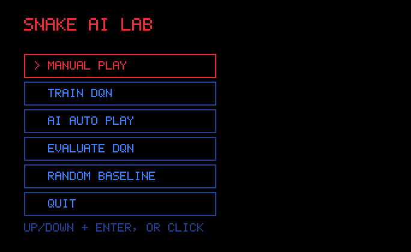
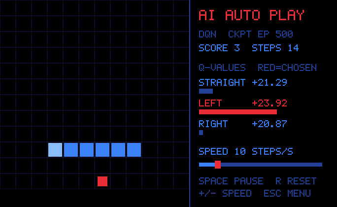
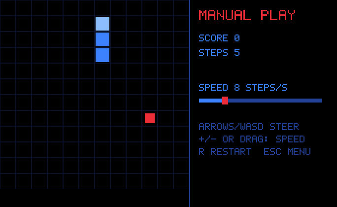
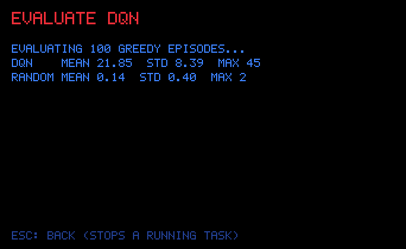
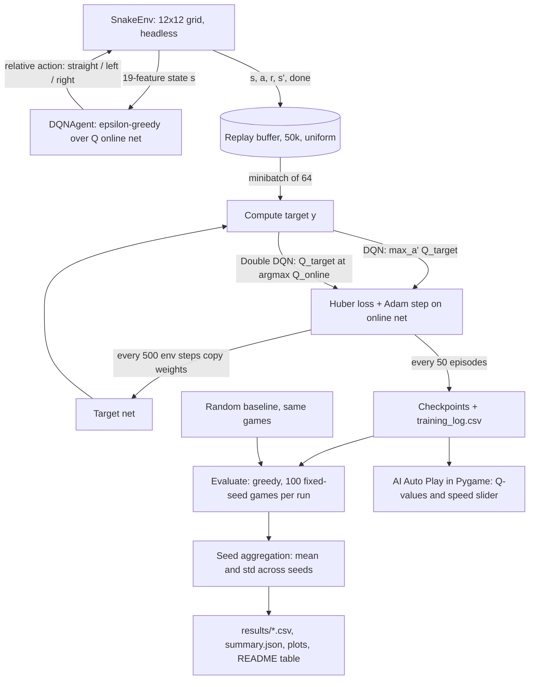

# Snake AI Lab

A Deep Q-Network (DQN) agent that learns to play Snake on a 12x12 grid, compared against Double DQN and a random
baseline. It has a headless training and evaluation pipeline, seed-averaged results, training curves, a checkpoint
comparison and a Pygame front end (menu, Manual Play, AI Auto Play with live Q-values).

Course project, third-year B.Tech (AI & Data Science).

> **Provenance note.** This repository is a **v1 rebuild from a written spec**. The student's earlier version of this
> project was not available when this code was written, so none of its code, results or scores are reused here.
> Every number in this README is generated by this code into `results/` (see `results/summary.json`).

## Quick start

**Windows** (needs Python 3.12 installed; nothing else):

```bat
run.bat -Quick      :: setup + tests + quick pipeline into results_quick\   (about 1.5 min once installed)
run.bat -UI         :: setup + open the Pygame menu
run.bat             :: setup + tests + full pipeline into results\           (about 30+ min on 2 CPU cores)
```

**Linux / WSL2 / macOS:**

```bash
./run_all.sh --quick
./run_all.sh --ui
./run_all.sh
```

Each command creates a virtual environment if there is none (`.venv312` on Windows, `.venv` on Linux), installs the
requirements once (CPU-only PyTorch first), runs the test suite, then runs the pipeline or opens the UI.
The first run downloads PyTorch, so it takes longer.

- **Quick mode** trains 2 seeds x {DQN, Double DQN} x 60 episodes and evaluates on 20 games each. It writes only to
  `results_quick/` and never touches `results/` or this README (`run_all.py` refuses `--quick` with `--out results`).
  Quick-mode scores (around 8) are a smoke test, not results.
- **Full mode** reruns the reported protocol (5 seeds x 2 variants x 500 episodes, 100 eval games per run). It
  **overwrites** `results/` and the results block in this README.
- Extra options: `run.bat -Quick -SkipTests`, `run.bat -Seeds 3`, `run.bat -Workers 4`; on Linux `--skip-tests`
  and any `run_all.py` option (`--seeds`, `--episodes`, `--eval-episodes`, `--workers`, `--skip-train`).

`run.bat` calls `run.ps1` with `-ExecutionPolicy Bypass`, so no PowerShell policy change is needed.
The trained models in `results/runs/` are committed, so the UI and evaluation work right after cloning without training.

## Features

- Headless Snake environment (`snakelab/env.py`, no Pygame): 12x12 grid, walls kill, 3 relative actions
  (straight / left / right), hand-designed 19-feature state.
- DQN with experience replay and a target network; Double DQN as an ablation with identical hyperparameters.
- One-command pipeline: training of all (variant, seed) runs in parallel, greedy evaluation on fixed-seed games,
  random baseline on the same games, checkpoint comparison, CSV/JSON/Markdown tables and plots.
- Pygame UI (black/blue/red pixel theme, bitmap font):
  - **Manual Play**: arrows/WASD, speed slider (2-30 steps/s, drag or +/-), R restart, ESC menu.
  - **AI Auto Play**: the trained agent plays; live Q-values for each action with the chosen one highlighted;
    speed slider (1-60 steps/s); SPACE pause, R reset.
  - **Evaluate DQN** and **Random Baseline** from the menu (run headless code in a background thread).
- pytest suite (35 tests) for the environment, replay buffer, agent and headless UI smoke tests.

## Screenshots

| Menu | AI Auto Play (Q-values and speed slider) |
|---|---|
|  |  |

| Manual Play | Evaluate DQN |
|---|---|
|  |  |

## Project structure

```
snake-ai-lab/
├── main.py              # single entry point: python main.py <command> (no command = Pygame menu)
├── run_all.py           # pipeline: train -> evaluate -> compare checkpoints -> tables + plots
├── run.bat / run.ps1    # Windows one-command setup + run
├── run_all.sh           # Linux/WSL2/macOS one-command setup + run
├── requirements.txt
├── snakelab/
│   ├── env.py           # game rules + 19 features (no Pygame)
│   ├── replay.py        # uniform replay buffer
│   ├── agent.py         # DQN / Double DQN agent (MLP, targets, save/load)
│   ├── train.py         # training loop, logs, checkpoints
│   ├── evaluate.py      # greedy / random evaluation on fixed seeds
│   ├── pipeline.py      # run_all logic, tables, README results block
│   ├── plots.py         # Matplotlib figures
│   ├── config.py        # hyperparameters
│   ├── cli.py           # command-line interface
│   ├── ui.py            # Pygame screens and Slider
│   └── pixelfont.py     # 5x7 bitmap font
├── tests/               # pytest suite
├── results/             # reported full-run outputs (models, CSVs, summary.json, plots)
├── results_quick/       # quick-mode outputs (git-ignored)
└── docs/                # screenshots, methodology, feature table, viva notes, session logs
```

## Manual setup

The one-command scripts do this for you. **Use Python 3.12.** Python 3.14 does not work: pygame 2.6.1 has no wheel
for it and fails to build from source.

Windows (PowerShell):

```powershell
py -3.12 -m venv .venv312
.\.venv312\Scripts\Activate.ps1
pip install torch --index-url https://download.pytorch.org/whl/cpu
pip install --timeout 120 --retries 5 -r requirements.txt
python -m pytest -q
python main.py
```

Linux / WSL2:

```bash
python3.12 -m venv .venv && source .venv/bin/activate
pip install torch --index-url https://download.pytorch.org/whl/cpu
pip install -r requirements.txt
python -m pytest -q
python main.py
```

If the CPU index is unreachable, plain `pip install torch` also works (bigger download, still runs on CPU).
The Pygame window works on native Windows; inside WSL2 it needs WSLg (Windows 11) or an X server.
Training and evaluation need no display.

## Commands (`python main.py <command>`, inside the venv)

| Mode | Command | What it does |
|---|---|---|
| Menu | `python main.py` | Pygame menu with all modes |
| Manual Play | `python main.py manual` | You steer (absolute keys are converted to relative actions; a 180-degree reversal is ignored) |
| AI Auto Play | `python main.py autoplay [--checkpoint path]` | Greedy agent plays with live Q-values |
| Train | `python main.py train [--variant dqn\|double] [--seed 0] [--episodes 500]` | Headless training; log, checkpoints every 50 episodes, `final.pt` |
| Evaluate | `python main.py evaluate [--checkpoint path] [--episodes 100]` | Greedy agent vs random baseline on the same seeded games |
| Random Baseline | `python main.py random` | Uniform random relative actions, 100 games |
| Checkpoint compare | `python main.py compare --dir <checkpoints dir>` | Evaluates every saved checkpoint of a run |
| Pipeline | `python run_all.py [--quick]` | Same pipeline the one-command scripts run (no setup, no tests) |

Auto Play and Evaluate default to `results/runs/dqn_seed0/final.pt`.

## How it works



### The 19 state features

Heading-relative where noted ("left"/"right" are relative to the current heading). All values are in [-1, 1].

| # | Name | Definition |
|---|---|---|
| 0 | danger_straight | 1 if the cell ahead is a wall or snake body |
| 1 | danger_left | 1 if the cell to the left is a wall or body |
| 2 | danger_right | 1 if the cell to the right is a wall or body |
| 3-6 | dir_up, dir_right, dir_down, dir_left | one-hot absolute heading |
| 7-10 | food_up, food_right, food_down, food_left | 1 if the food is strictly in that absolute direction from the head |
| 11 | food_dx_norm | (food_x - head_x) / (width - 1), signed |
| 12 | food_dy_norm | (food_y - head_y) / (height - 1), signed (y grows downward) |
| 13 | ray_straight | free-cell distance to the first wall/body cell straight ahead, / 12 |
| 14 | ray_left | same, to the left |
| 15 | ray_right | same, to the right |
| 16 | length_norm | snake length / (width * height) |
| 17 | free_space_ahead | cells reachable by flood fill from the cell ahead / total free cells (0 if ahead is blocked) |
| 18 | hunger | steps since last food / hunger limit (limit = 100 + 5 * length) |

### Reward and termination

+10 for eating food, -10 for death (wall, body, starvation), +0.1 / -0.1 per step that moves closer to / farther from
the food (Manhattan distance, a small shaping signal), 0 otherwise. Moving into the cell the tail is vacating is legal.
An episode ends with `starved` if the snake goes longer than the hunger limit without eating; this is treated as
terminal in the TD target (a simplification: it is really a time-limit truncation).

### Hyperparameters (identical for DQN and Double DQN, not tuned)

| Parameter | Value |
|---|---|
| Network | MLP 19 -> 128 -> 128 -> 3, ReLU |
| Optimizer / loss | Adam, lr 1e-3 / Huber (smooth L1), grad-norm clip 10 |
| Discount gamma | 0.95 |
| Batch size / buffer | 64 / 50,000 transitions, uniform sampling |
| Learning starts | after 1,000 transitions; one gradient step per env step |
| Target network | hard copy every 500 env steps |
| Epsilon | 1.0 -> 0.01, multiplied by 0.99 after each episode |
| Training episodes | 500 per run |
| Checkpoints | every 50 episodes + final |
| Evaluation | greedy (epsilon = 0), 100 games per run, env seeds 1,000,000..1,000,099, identical across policies |

The only difference between the variants is `DQNAgent.compute_targets`: DQN uses `max_a' Q_target(s',a')`,
Double DQN uses `Q_target(s', argmax_a' Q_online(s',a'))`.

## Results

Produced by `python run_all.py --seeds 5` (training), then `python run_all.py --skip-train --seeds 5`
(evaluation and plots, re-run after an interruption). "Mean of seed means" = for each training seed, average its
100 evaluation games, then average those per-seed means; "std across seeds" is the sample standard deviation (ddof=1)
of the per-seed means. The block between the markers is rewritten by a full run.

<!-- RESULTS_START -->
| Policy | Seeds | Train episodes | Eval episodes / seed | Mean eval score (mean of seed means) | Std across seeds | Min..Max seed mean | Max single-game score |
|---|---|---|---|---|---|---|---|
| Random | 5 | n/a | 100 | 0.15 | 0.05 | 0.08..0.23 | 2 |
| DQN | 5 | 500 | 100 | 21.66 | 0.73 | 20.50..22.38 | 46 |
| Double DQN | 5 | 500 | 100 | 20.56 | 0.53 | 19.88..21.17 | 48 |

Per-seed mean scores (each over 100 eval games):

| Policy | seed 0 | seed 1 | seed 2 | seed 3 | seed 4 |
|---|---|---|---|---|---|
| Random | 0.14 | 0.08 | 0.23 | 0.16 | 0.13 |
| DQN | 22.38 | 21.55 | 22.16 | 21.69 | 20.50 |
| Double DQN | 20.78 | 19.88 | 20.13 | 21.17 | 20.82 |

Checkpoint comparison (mean ± std across seeds of per-checkpoint mean eval score):

| Checkpoint (episode) | DQN | Double DQN |
|---|---|---|
| 50 | 11.14 ± 1.80 | 9.02 ± 2.77 |
| 100 | 12.24 ± 5.74 | 12.78 ± 3.14 |
| 150 | 15.09 ± 1.99 | 14.26 ± 3.46 |
| 200 | 17.40 ± 2.36 | 16.66 ± 2.59 |
| 250 | 18.67 ± 1.62 | 18.97 ± 1.01 |
| 300 | 20.22 ± 1.61 | 19.87 ± 1.19 |
| 350 | 19.95 ± 0.89 | 19.96 ± 0.95 |
| 400 | 19.66 ± 0.68 | 20.95 ± 1.07 |
| 450 | 21.22 ± 1.00 | 20.62 ± 0.96 |
| 500 | 21.66 ± 0.73 | 20.56 ± 0.53 |

_Generated by `python run_all.py` from `results/summary.json`; 5 seeds, 500 training episodes, 100 eval episodes per seed._
<!-- RESULTS_END -->

Plots in `results/plots/`: `training_curves_dqn_seed0.png`, `training_curves_double_seed0.png` (score with moving
average, loss, epsilon), `training_dqn_vs_double.png` (seed-averaged training curves), `eval_scores.png`,
`checkpoint_compare.png`. Per-game and per-run data: `results/eval_episodes.csv`, `results/eval_per_run.csv`.

**Reading the results honestly:**

- Both trained agents are far above the random baseline.
- **Double DQN did not beat DQN** in this run: its mean of seed means is lower, the per-seed ranges partly overlap,
  and with 5 seeds and **no significance test** neither variant can be called better.
- Trained agents mostly die by running into their own body (435 of 500 DQN eval games, 461 of 500 Double DQN games;
  the rest hit a wall). No evaluation game ended by starvation and none filled the board.
- The max single-game scores (46, 48) are single games, not typical performance.
- The checkpoint table uses the same evaluation games as the headline, so picking the best checkpoint from it would be
  optimistic; the headline uses the final checkpoint only.
- Scores are still rising slowly at episode 500 (see the plots); 500 episodes is the protocol, not convergence.

## Tests

```bash
python -m pytest -q        # 35 tests; SDL_VIDEODRIVER=dummy is set automatically by tests/conftest.py
```

Covers movement, relative turns, wall/body collisions, the tail-vacating rule, food/growth, starvation, the 19-feature
vector (shape, dtype and hand-computed values), the replay buffer, the agent (Q shape, epsilon, target sync, DQN vs
Double DQN targets checked by hand, save/load, seeded reproducibility) and headless Pygame smoke tests.
The one-command scripts run the suite before the pipeline.

## Limitations and future work

| Item | Status |
|---|---|
| Statistical significance testing, more seeds, longer training, hyperparameter sweeps | Future work |
| Starvation treated as terminal instead of as a time-limit truncation | Known simplification |
| Hand-designed 19-feature state (no learning from raw pixels / grid) | By design; grid input is future work |
| Other RL methods (dueling networks, prioritized replay, PPO, ...) | Future work |
| Optimal / board-filling play | Not achieved |
| The 19 features checked against hand-built boards beyond the unit tests | Not done |
| ESP32 deployment | Future work (nothing built or tested) |

## References

1. V. Mnih et al., "Human-level control through deep reinforcement learning", *Nature* 518, 529-533, 2015.
2. V. Mnih et al., "Playing Atari with Deep Reinforcement Learning", arXiv:1312.5602, 2013.
3. R. S. Sutton and A. G. Barto, *Reinforcement Learning: An Introduction*, 2nd ed., MIT Press, 2018.
4. H. van Hasselt, A. Guez, D. Silver, "Deep Reinforcement Learning with Double Q-learning", AAAI 2016.
