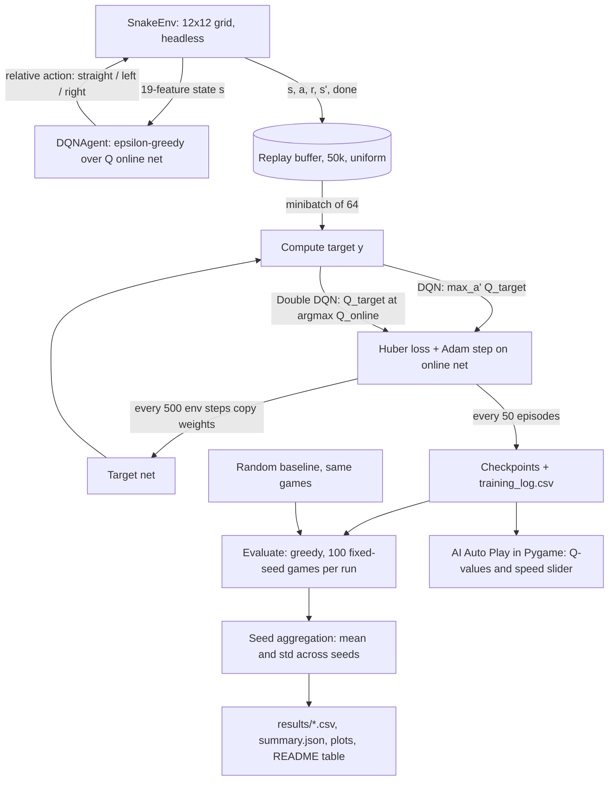

# Snake AI Lab

A Deep Q-Network (DQN) agent that learns to play Snake on a 12x12 grid, with a Pygame front end, a headless
training/evaluation pipeline, a Double DQN ablation, seed-averaged evaluation against a random baseline,
training curves and a checkpoint comparison.

> **Provenance note.** This repository is a **v1 rebuild from a written spec**. The student's earlier version of this
> project was not available when this code was written, so none of its code, results or scores are reused here.
> Every number in this README is generated by this code into `results/` (see `results/summary.json`).

Course project, third-year B.Tech (AI & Data Science). Review date: 14 Nov 2026.

## Project info

| Item | Value |
|---|---|
| Task | Learn Snake from a hand-designed 19-feature state, 3 relative actions |
| Algorithms | DQN (Mnih et al. 2015) and Double DQN (van Hasselt et al. 2016), same hyperparameters |
| Stack | Python, PyTorch (CPU), NumPy, Pygame, Matplotlib, pytest |
| Board | 12x12, walls kill, snake starts with length 3 in the centre |
| Protocol | train N episodes per run, then 100 greedy evaluation games per run, vs a uniform-random baseline |

## Screenshots

Rendered from this code without a display (frames saved from the Pygame surface). Mouse and keyboard handling on a real
Windows display still needs to be tried by hand.

| Menu | AI Auto Play (Q-values and speed slider) |
|---|---|
|  |  |

| Manual Play | Evaluate DQN |
|---|---|
|  |  |

## Setup

Python 3.10+ (developed against 3.13 in the sandbox; the target is 3.12 on Windows and WSL2).

```bash
# 1. CPU-only PyTorch (smaller download, no CUDA needed). Windows PowerShell or WSL2:
pip install torch --index-url https://download.pytorch.org/whl/cpu
# 2. everything else
pip install numpy pygame matplotlib pytest
```

If the CPU index is unreachable, plain `pip install torch` also works (bigger download; it still trains on CPU).
In the build sandbox the CPU index was blocked and torch came from PyPI.

Use plain `python` on both Windows and WSL2 (`python main.py ...`). The Pygame window works on native Windows;
inside WSL2 it needs WSLg (Windows 11) or an X server. Training/evaluation need no display.

## One-command run

```bash
python run_all.py            # full: trains DQN and Double DQN across seeds, evaluates, plots, tables, refreshes the results block below
python run_all.py --quick    # tiny smoke run into results_quick/ (README is not touched)
```

Options: `--seeds N` (default 3), `--episodes N` (default 500), `--eval-episodes N` (default 100), `--workers N` (processes, default 2),
`--skip-train` (re-evaluate/re-plot existing runs). `./run_all.sh` is a thin wrapper.
The results table below was produced with `python run_all.py --seeds 5` (training), then `python run_all.py --skip-train --seeds 5` (evaluation/plots, re-run after an interruption); the default is 3 seeds.

Outputs in `results/`: `runs/<variant>_seed<k>/{training_log.csv,final.pt,checkpoints/}`, `eval_episodes.csv`, `eval_per_run.csv`,
`checkpoint_compare*.csv`, `summary.json`, `results_table.md`, `plots/*.png`, `run_all.log`.

## Modes (single entry point: `python main.py <command>`)

| Mode | Command | What it does |
|---|---|---|
| Menu | `python main.py` | Pygame menu with all five modes |
| Manual Play | `python main.py manual` | You steer with arrows/WASD (absolute keys are converted to relative actions; a 180-degree reversal is ignored). Speed slider (drag) or +/-, 2-30 steps/s. R restart, ESC menu |
| Train DQN | `python main.py train [--variant dqn\|double] [--seed 0] [--episodes 500]` | Headless training; writes log, checkpoints every 50 episodes and `final.pt` |
| AI Auto Play | `python main.py autoplay [--checkpoint path]` | Greedy agent plays in Pygame; live Q-values for straight/left/right (chosen action highlighted); speed slider (drag) or +/-; SPACE pause; R reset |
| Evaluate DQN | `python main.py evaluate [--checkpoint path] [--episodes 100]` | Greedy agent vs random baseline on the same 100 seeded games |
| Random Baseline | `python main.py random` | Uniform random relative actions, 100 games |
| Checkpoint compare | `python main.py compare --dir <checkpoints dir>` | Evaluates every saved checkpoint of a run and tabulates it |

The menu's Train/Evaluate/Random entries run the same headless code in a background thread and print text status in the window.
Auto Play and Evaluate default to `results/runs/dqn_seed0/final.pt`, so run `python run_all.py` (or `python main.py train`) first.

## Flow



Code layout: `snakelab/env.py` (rules + features, no Pygame), `replay.py`, `agent.py` (DQN and Double DQN), `train.py`,
`evaluate.py`, `plots.py`, `pipeline.py` (run_all logic), `ui.py` (Pygame only), `cli.py`.

## The 19 state features

Heading-relative where noted ("left"/"right" are relative to the current heading). All values are in [-1, 1].

| # | Name | Definition |
|---|---|---|
| 0 | danger_straight | 1 if the cell ahead is a wall or snake body |
| 1 | danger_left | 1 if the cell to the left is a wall or body |
| 2 | danger_right | 1 if the cell to the right is a wall or body |
| 3-6 | dir_up, dir_right, dir_down, dir_left | one-hot absolute heading |
| 7-10 | food_up, food_right, food_down, food_left | 1 if the food is strictly in that absolute direction from the head |
| 11 | food_dx_norm | (food_x - head_x) / (width - 1), signed |
| 12 | food_dy_norm | (food_y - head_y) / (height - 1), signed (y grows downward) |
| 13 | ray_straight | free-cell distance to the first wall/body cell straight ahead, / 12 |
| 14 | ray_left | same, to the left |
| 15 | ray_right | same, to the right |
| 16 | length_norm | snake length / (width * height) |
| 17 | free_space_ahead | cells reachable by flood fill from the cell ahead / total free cells (0 if ahead is blocked). A body-trap detector |
| 18 | hunger | steps since last food / hunger limit (limit = 100 + 5 * length) |

Because features 3-12 are absolute-frame and 0-2, 13-17 are heading-relative, the network must combine both frames.
Note the hunger limit: an episode ends with `cause = starved` (reward -10) if the snake wanders too long without eating;
this prevents endless loops but the hunger feature makes the cutoff observable to the agent.

## Reward, termination

+10 eat food, -10 death (wall, body, starvation), +0.1 / -0.1 per step that moves closer to / farther from the food
(Manhattan distance, a small shaping signal), 0 otherwise. Moving into the cell the tail is vacating is legal.
Starvation is treated as a terminal state in the TD target (a simplification: it is really a time-limit truncation).

## Hyperparameters (identical for DQN and Double DQN)

| Parameter | Value |
|---|---|
| Network | MLP 19 -> 128 -> 128 -> 3, ReLU |
| Optimizer / loss | Adam, lr 1e-3 / Huber (smooth L1), grad-norm clip 10 |
| Discount gamma | 0.95 |
| Batch size / buffer | 64 / 50,000 transitions, uniform sampling |
| Learning starts | after 1,000 transitions; one gradient step per env step |
| Target network | hard copy every 500 env steps |
| Epsilon | 1.0 -> 0.01, multiplied by 0.99 after each episode |
| Training episodes | 500 per run (protocol default) |
| Checkpoints | every 50 episodes + final |
| Evaluation | greedy (epsilon = 0), 100 games per run, env seeds 1,000,000..1,000,099, identical across policies |

The only difference between the variants is `DQNAgent.compute_targets`: DQN uses `max_a' Q_target(s',a')`, Double DQN uses
`Q_target(s', argmax_a' Q_online(s',a'))`. Hyperparameters were **not tuned**; one setting was chosen up front.

## Results

All numbers below are written by `run_all.py`. "Mean of seed means" = for each training seed, average the 100 evaluation
games, then average those per-seed means; "std across seeds" is the sample standard deviation (ddof=1) of the per-seed means.

<!-- RESULTS_START -->
| Policy | Seeds | Train episodes | Eval episodes / seed | Mean eval score (mean of seed means) | Std across seeds | Min..Max seed mean | Max single-game score |
|---|---|---|---|---|---|---|---|
| Random | 5 | n/a | 100 | 0.15 | 0.05 | 0.08..0.23 | 2 |
| DQN | 5 | 500 | 100 | 21.66 | 0.73 | 20.50..22.38 | 46 |
| Double DQN | 5 | 500 | 100 | 20.56 | 0.53 | 19.88..21.17 | 48 |

Per-seed mean scores (each over 100 eval games):

| Policy | seed 0 | seed 1 | seed 2 | seed 3 | seed 4 |
|---|---|---|---|---|---|
| Random | 0.14 | 0.08 | 0.23 | 0.16 | 0.13 |
| DQN | 22.38 | 21.55 | 22.16 | 21.69 | 20.50 |
| Double DQN | 20.78 | 19.88 | 20.13 | 21.17 | 20.82 |

Checkpoint comparison (mean ± std across seeds of per-checkpoint mean eval score):

| Checkpoint (episode) | DQN | Double DQN |
|---|---|---|
| 50 | 11.14 ± 1.80 | 9.02 ± 2.77 |
| 100 | 12.24 ± 5.74 | 12.78 ± 3.14 |
| 150 | 15.09 ± 1.99 | 14.26 ± 3.46 |
| 200 | 17.40 ± 2.36 | 16.66 ± 2.59 |
| 250 | 18.67 ± 1.62 | 18.97 ± 1.01 |
| 300 | 20.22 ± 1.61 | 19.87 ± 1.19 |
| 350 | 19.95 ± 0.89 | 19.96 ± 0.95 |
| 400 | 19.66 ± 0.68 | 20.95 ± 1.07 |
| 450 | 21.22 ± 1.00 | 20.62 ± 0.96 |
| 500 | 21.66 ± 0.73 | 20.56 ± 0.53 |

_Generated by `python run_all.py` from `results/summary.json`; 5 seeds, 500 training episodes, 100 eval episodes per seed._
<!-- RESULTS_END -->

Plots (in `results/plots/`): `training_curves_dqn_seed0.png`, `training_curves_double_seed0.png` (score + moving average,
loss, epsilon), `training_dqn_vs_double.png` (seed-averaged training curves), `eval_scores.png`, `checkpoint_compare.png`.

Reading the results honestly: in this run Double DQN did **not** beat vanilla DQN (its mean of seed means is lower than DQN's in the table above; the seed ranges overlap partly, and 5 seeds with no significance test cannot establish a real difference either way). Both are far above the random baseline. See `PROGRESS.md` ("Interpretation and caveats").
The checkpoint table reports the mean over seeds of each checkpoint's score on the same evaluation games that the final
numbers use; picking the best checkpoint from it would be optimistic (selection on the test games), so the headline row
uses the final checkpoint only.

## Implemented vs future scope

| Item | Status |
|---|---|
| Custom headless Snake env, 19 features, 3 relative actions | Implemented, unit-tested |
| DQN with replay + target network | Implemented, unit-tested |
| Double DQN as an ablation, same hyperparameters | Implemented, run with the seeds shown above |
| Seed-averaged evaluation vs random baseline | Implemented |
| Training curves, checkpoint compare | Implemented |
| Pygame: Manual Play and AI Auto Play (both with speed slider; Q-values in Auto Play), menu; pixel-font black/blue/red theme | Implemented; only smoke-tested headless, **not visually verified** |
| Statistical significance testing, > 5 seeds, longer training, hyperparameter sweeps | Future work |
| Other RL algorithms (PPO, dueling, prioritized replay, ...) | Future work |
| Optimal / board-filling play | Future work (not achieved) |
| ESP32 deployment | Future work (nothing built or tested) |

## Tests

```bash
python -m pytest -q        # SDL_VIDEODRIVER=dummy is set automatically by tests/conftest.py
```
Covers movement, relative turns, wall/body collisions, tail-vacating rule, food/growth, starvation, the 19-feature vector
(shape, dtype and hand-computed values), replay buffer, agent (Q shape, epsilon, target sync, DQN-vs-Double targets by hand,
save/load, seeded reproducibility) and headless Pygame smoke tests. The latest output is saved in `results/pytest_output.txt`.

## References

1. V. Mnih et al., "Human-level control through deep reinforcement learning", *Nature* 518, 529-533, 2015.
2. V. Mnih et al., "Playing Atari with Deep Reinforcement Learning", arXiv:1312.5602, 2013.
3. R. S. Sutton and A. G. Barto, *Reinforcement Learning: An Introduction*, 2nd ed., MIT Press, 2018.
4. H. van Hasselt, A. Guez, D. Silver, "Deep Reinforcement Learning with Double Q-learning", AAAI 2016.
